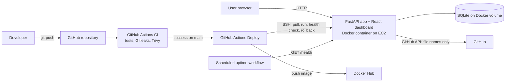
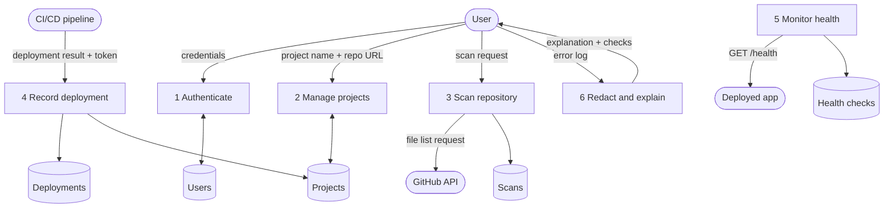
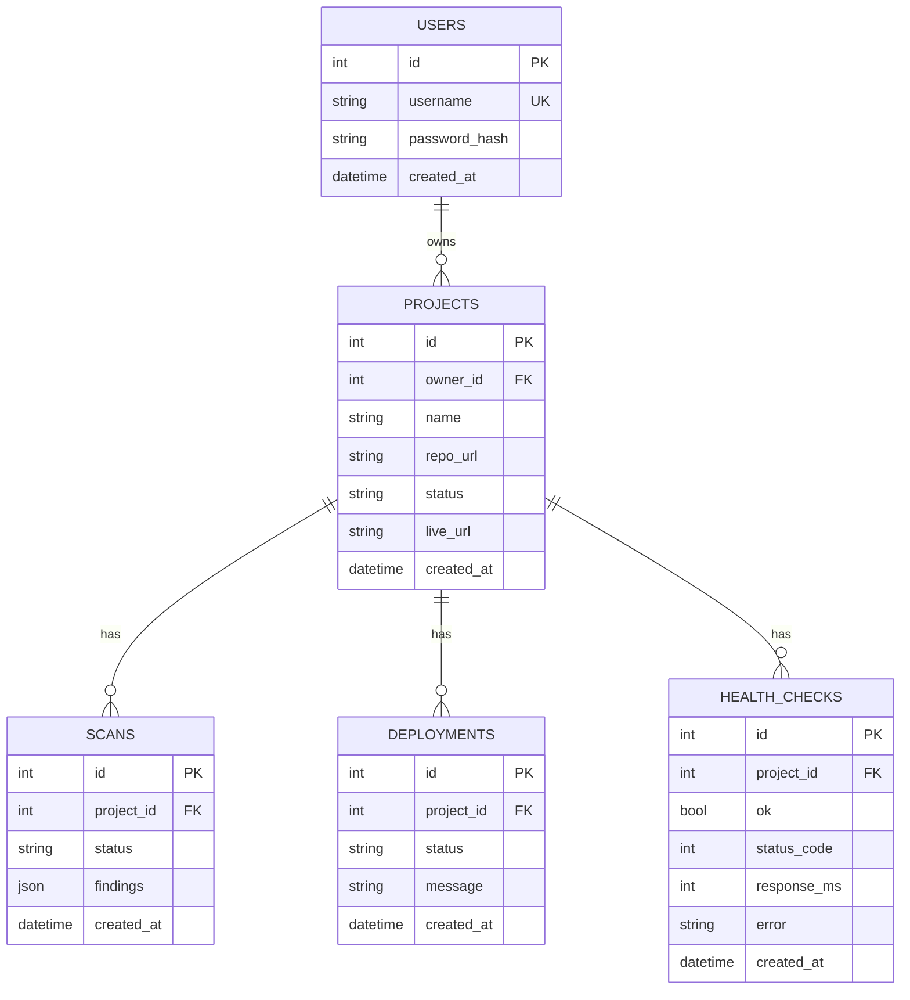
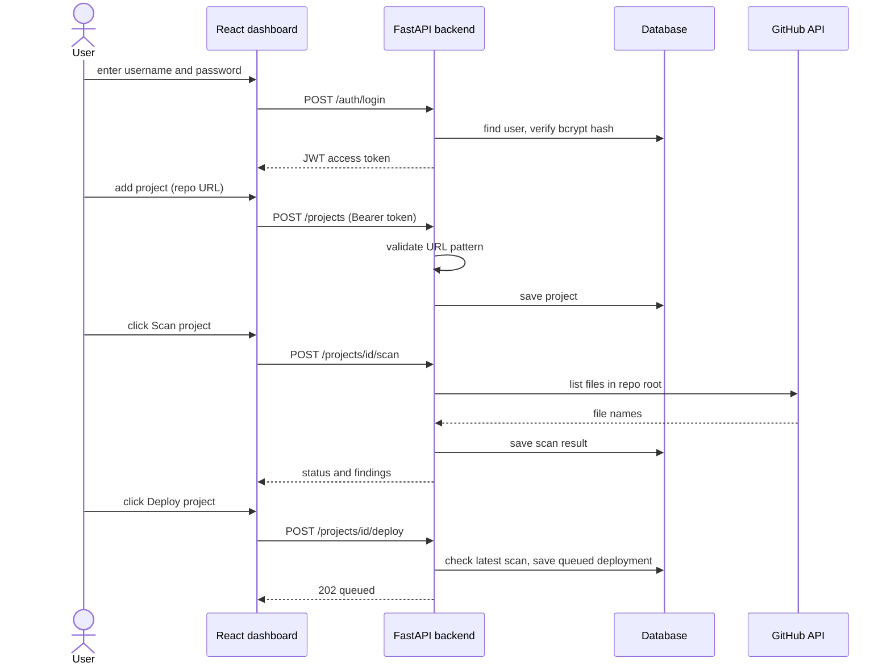
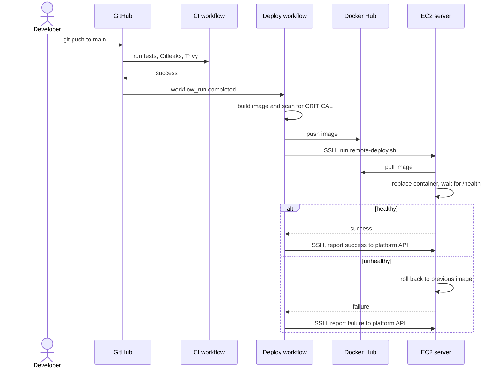

# Final-year report kit

Use this as the skeleton of your report, PPT and viva prep. **Rewrite everything in your own words**, add your own screenshots and real results, and delete anything that does not match what you actually built and ran. Examiners can tell copied text, and your viva is about YOUR understanding.

Diagrams are written in Mermaid. They render on GitHub, or paste them into https://mermaid.live to export PNG/SVG. For the formal UML use-case diagram, redraw the actors and use cases in draw.io.

---

## 1. Problem statement
Beginners can build a web app on their laptop but struggle to ship it. Deployment needs servers, Docker, SSH and CI/CD knowledge; secrets leak into public repositories; vulnerable dependencies go unnoticed; and when a deployment fails, raw logs are hard to understand. This project provides a simple platform that tests, scans, packages, deploys and monitors an application, and explains errors in plain language.

## 2. Objectives
1. Provide secure user registration and login (hashed passwords, JWT).
2. Let a user register a GitHub project and run a safe pre-flight scan without executing the project's code.
3. Automate testing, secret scanning and vulnerability scanning in a CI/CD pipeline, with simple deployment rules.
4. Deploy a Docker container to a single AWS EC2 instance automatically, with a health check and automatic rollback.
5. Monitor server resources and application uptime and raise a basic alert.
6. Explain common errors in simple language after removing secrets from the log.
7. Keep cloud cost under control with budgets and the smallest resources.

## 3. Literature survey topics (search IEEE, Google Scholar, official docs)
- CI/CD pipelines and DevOps practices; DevSecOps and "shift-left" security
- Containerization with Docker vs virtual machines
- Platform-as-a-Service systems (Heroku, Vercel, Render) and their architecture
- Secret leakage in public repositories (Gitleaks, GitHub secret scanning)
- Software composition analysis and container image vulnerability scanning (Trivy, CVE, CVSS)
- JWT and password hashing (bcrypt), OWASP Top 10, OWASP API Security Top 10
- Application monitoring and observability (Prometheus, Grafana, health checks)
- Log analysis and automated root-cause assistance; large language models for log explanation
- Cloud cost management for students (AWS Budgets, free tier / credits)

## 4. Limitations of existing systems
- Heroku/Vercel/Render hide the internals, so students learn little about deployment; free tiers are limited or paid.
- Raw GitHub Actions or AWS require a lot of prior knowledge and manual wiring.
- Security scanning is usually a separate, optional tool that beginners never set up.
- Error messages are written for experts.

## 5. Advantages of the proposed system
- One simple dashboard for register > scan > deploy > monitor > explain.
- Security checks are part of the pipeline by default, with clear stop rules.
- Transparent and educational: every stage is visible and uses open-source tools.
- Low cost: one small instance, free CI minutes, free scanners.
- Error explanations remove secrets before processing, and the AI part is optional.

## 6. Functional requirements
| ID | Requirement |
|---|---|
| FR-1 | A user can register and log in; passwords are stored only as hashes |
| FR-2 | An authenticated user can create, list and view only their own projects |
| FR-3 | The system validates GitHub repository URLs (https, github.com, owner/repo only) |
| FR-4 | A user can trigger a scan that checks repository readiness without running the code |
| FR-5 | Deployment is blocked if there is no scan or the latest scan failed |
| FR-6 | The pipeline runs tests, secret scan, dependency scan and image scan |
| FR-7 | The pipeline stops on failed tests, detected secrets or CRITICAL vulnerabilities; lower severities are warnings |
| FR-8 | The pipeline builds an image, pushes it to a registry and deploys it to EC2 |
| FR-9 | After deployment a health check runs; a failed new version is rolled back |
| FR-10 | The dashboard shows scan results, deployment history and the live URL |
| FR-11 | The system shows CPU, memory, disk and per-project uptime and response time |
| FR-12 | A scheduled check alerts the owner when the application is down |
| FR-13 | A user can submit an error log and get an explanation and suggested checks; secrets are redacted first |

## 7. Non-functional requirements
- **Security:** hashed passwords, signed expiring tokens, input validation, least-privilege container (non-root, dropped capabilities), secrets in environment files and GitHub Secrets only.
- **Cost:** one t3.micro-class instance, budget alerts, stop/terminate after use.
- **Reliability:** container restart policy, health checks, automatic rollback.
- **Usability:** a small number of simple pages, plain-language messages.
- **Maintainability:** automated test suite (61 tests), Infrastructure described in files (Dockerfile, workflows, scripts).
- **Portability:** the same Docker image runs on a laptop and on EC2.

## 8. System architecture

## 9. Data-flow diagram (level 1)

## 10. Use cases (actors and cases to draw in draw.io)
- **User:** Register, Log in, Create project, Scan project, View scan results, Request deployment, View deployment history, View monitoring, Submit error log for explanation.
- **CI/CD pipeline (system actor):** Run tests, Scan for secrets, Scan image, Build and push image, Deploy to EC2, Report deployment result.
- **Scheduler (system actor):** Run uptime check.

## 11. Database ER diagram

## 12. Sequence diagrams
**Register, scan and request deployment**

**Automated deployment**

## 13. Module descriptions
| Module | Files | What it does |
|---|---|---|
| Authentication | `security.py`, `deps.py`, `routers/auth.py` | bcrypt hashing, JWT creation and checking, "who is logged in" dependency |
| Projects and scan | `routers/projects.py`, `scanner.py` | CRUD for projects, strict URL validation, GitHub-API-based pre-flight scan, deploy rules |
| Deployment reporting | `routers/deployments.py` | Receives pipeline results, protected by a shared token compared in constant time |
| Monitoring | `routers/monitoring.py` | psutil system stats, `/health` checks, uptime and response-time summary |
| Error explainer | `explainer.py`, `routers/explain.py` | Secret redaction then rule-based matching of 14 common error patterns |
| Frontend | `frontend/src` | Login, projects and results, monitoring, error explanation pages |
| CI | `.github/workflows/ci.yml` | Tests, Gitleaks, Trivy (files and image) |
| CD | `.github/workflows/deploy.yml`, `deploy/*.sh` | Build, scan, push, deploy over SSH, health check, rollback, report |
| Uptime alert | `.github/workflows/uptime.yml` | Scheduled `/health` call; a failed run emails the owner |

## 14. Technology justification
| Technology | Why |
|---|---|
| Python FastAPI | Beginner friendly, automatic validation and Swagger docs, widely used in industry |
| SQLAlchemy + SQLite/PostgreSQL | Same code runs on a single file (simple) or PostgreSQL (production-style) |
| React + Vite | Fast to build a dashboard; common in interviews |
| Docker | Same package everywhere; required for modern DevOps |
| GitHub Actions | Free CI/CD next to the code |
| Gitleaks | Open-source secret scanning including git history |
| Trivy | Open-source scanner for dependencies and container images |
| AWS EC2 | Core cloud skill; smallest instance keeps cost low |
| Docker Hub | Free registry, simpler than ECR for a first project |
| bcrypt + JWT | Standard password storage and stateless login |

## 15. Testing results
Use `docs/TEST_PLAN.md`. Fill the manual rows with real results and screenshots, and paste the final line of `pytest -q` (for example "61 passed").

## 16. Limitations (be honest, this earns marks)
- HTTP only; no HTTPS or custom domain.
- Single instance, SQLite, no backups or scaling.
- The pre-flight scan only checks which files exist in the repo root; it is not a vulnerability scan of the user's code. The real checks run in the CI pipeline.
- The platform's pipeline deploys this application. Deploying arbitrary strangers' repositories would need sandboxing (isolated containers, resource limits, network restrictions), which is not implemented.
- Rule-based explainer covers a limited set of errors; no AI model is used.
- Access token stored in browser localStorage (XSS trade-off); no refresh tokens, login rate limiting or email verification.
- SSH port must be open to the internet for GitHub-hosted runners (key-only login).
- A clean scan does not prove an application is secure.

## 17. Future scope
HTTPS with Let's Encrypt; per-project deployments in isolated containers (or ECS/Kubernetes); GitHub webhooks and GitHub App login; Prometheus and Grafana dashboards; optional LLM-based error explanation with redaction and cost limits; rate limiting and two-factor login; infrastructure as code (Terraform); role-based access for teams and college labs.

## 18. Conclusion (starter)
The project shows that a secure, automated path from source code to a monitored running application can be built with open-source tools and very low cloud cost, and that making security checks, rollback and plain-language error explanation default parts of the pipeline helps beginners ship safer software.

---

## Viva questions and answers (practice saying them out loud)
1. **What problem does it solve?** Beginners find deployment hard, leak secrets and ship vulnerable code; the platform automates test, scan, deploy and monitor with plain-language errors.
2. **Why FastAPI?** Simple, fast, automatic validation (Pydantic) and automatic API docs, and Python is common in DevOps jobs.
3. **How are passwords stored?** Only as bcrypt hashes with a random salt; a test proves the plain text is never stored.
4. **How does JWT work?** After login the server signs a token containing the user id and an expiry. The browser sends it in the Authorization header; the server verifies the signature and expiry on every request.
5. **Why return 404 instead of 403 for other users' projects?** So attackers cannot learn that a project id exists.
6. **Is your scan a security audit?** No. It is a quick pre-flight check using the GitHub API. Real checks are Gitleaks, Trivy and tests in CI, and even those cannot prove an app is secure.
7. **Why not clone and run user repos?** Running untrusted code is dangerous (it could attack the server or steal secrets). It would need sandboxing and isolation, which are out of scope and listed as future work.
8. **How do you stop SSRF or injection through the repo URL?** A strict regex allows only `https://github.com/owner/repo`, and the server calls a fixed host (api.github.com).
9. **What do Gitleaks and Trivy do?** Gitleaks searches the code and git history for secrets. Trivy checks dependencies and the container image against known-vulnerability databases (CVEs) by severity.
10. **What are the deployment rules?** Failed tests, detected secrets or CRITICAL fixable vulnerabilities stop the pipeline; lower severities are warnings.
11. **What does Docker give you?** The same image runs on my laptop and on EC2, with dependencies packaged in.
12. **Explain your Dockerfile.** Multi-stage: stage one builds the React app with Node; stage two is a slim Python image that installs requirements, copies the app and the built frontend, runs as a non-root user and defines a health check.
13. **How does deployment work?** After CI passes on main, the Deploy workflow builds and scans the image, pushes it to Docker Hub, SSHes to EC2 and runs a script that pulls the image, replaces the container and waits for `/health`.
14. **What happens if the new version is broken?** The script detects the failed health check, restores the previous image and the workflow fails.
15. **How do you handle secrets?** `.env` files and GitHub Secrets only, never in the repo or image; the server generates its own random keys; log output is redacted.
16. **Why is the database not public?** Only the app container talks to it; no port is published, and the security group only opens 22 and 80.
17. **How do you monitor?** `/health` endpoint, psutil CPU/memory/disk, stored uptime checks with response times, and a scheduled workflow that fails (and emails me) when the app is down.
18. **What are your limitations?** HTTP only, single server, SQLite, not a sandbox for untrusted code, limited error rules, SSH open for CI runners.
19. **How did you control cost?** One small instance, budget alert, stop or terminate after use, no load balancer, NAT gateway or RDS.
20. **What would you do next?** HTTPS, isolated per-project deployments, Prometheus/Grafana, optional AI explanations with redaction, Terraform.
21. **Why does the error explainer redact first?** Logs often contain passwords or tokens; redaction must happen before storing or sending logs to any external service.
22. **How did you test?** 61 automated tests with pytest (auth, authorization, validation, scan rules, deployment reporting, monitoring, redaction) plus manual pipeline tests for failed tests, secrets, vulnerabilities, rollback and downtime.

## Five-minute demo script
| Time | Do | Say |
|---|---|---|
| 0:00 | Show the dashboard URL on EC2 | "This is my platform, running on one small AWS server in a Docker container." |
| 0:30 | Register and log in | "Passwords are bcrypt hashed; login returns a JWT." |
| 1:00 | Add the sample-app repo, click **Scan** | "The scan uses only the GitHub API; it never runs the code. Here it passes." |
| 1:30 | Add a repo with a committed `.env` (prepared beforehand) and scan | "A committed secret file is CRITICAL, so deployment is blocked." |
| 2:00 | Show GitHub Actions: CI jobs green | "Tests, Gitleaks and Trivy run on every push." |
| 2:30 | Push a tiny change; show Deploy running | "It builds, scans, pushes to Docker Hub and deploys over SSH." |
| 3:15 | Dashboard deployment history + live URL | "The result is reported back automatically." |
| 3:30 | Monitoring tab: CPU, memory, uptime | "Server metrics and uptime from health checks." |
| 4:00 | Paste an error log containing a fake password into **Explain an error** | "Secrets are removed first, then the error is explained in simple words." |
| 4:30 | Show the AWS budget and say you will terminate the instance | "Cost is controlled with a budget and I shut it down after use." |
| 5:00 | Stop | Finish with limitations and future scope in one sentence each. |

Keep a **recorded video backup** of this demo in case Wi-Fi or AWS fails on the day, and keep screenshots in your slides.

## Presentation outline (12 slides)
1. Title, your name, guide, college
2. Problem and motivation
3. Objectives
4. Existing systems and gaps
5. Proposed system overview
6. Architecture diagram
7. Technology stack and why
8. Security design (hashing, JWT, validation, secrets, scanning, rules)
9. CI/CD pipeline (stages and stop rules)
10. Monitoring and error explanation
11. Results: test table, screenshots, cost
12. Limitations, future scope, conclusion, thank you

## Project report structure
1. Title page, certificate, declaration, acknowledgement, abstract
2. Table of contents, list of figures and tables
3. Chapter 1 Introduction (background, problem statement, objectives, scope)
4. Chapter 2 Literature survey and existing systems
5. Chapter 3 System analysis (functional and non-functional requirements, feasibility, cost)
6. Chapter 4 System design (architecture, DFD, use cases, ER, sequence diagrams, module design)
7. Chapter 5 Implementation (technologies, key code explained, Docker, pipeline, AWS setup, security measures)
8. Chapter 6 Testing (test plan, results, screenshots)
9. Chapter 7 Results and discussion (demo screenshots, cost, performance observations)
10. Chapter 8 Limitations, conclusion and future scope
11. References and appendices (API list, repository link, setup guide)
